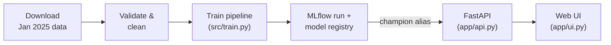

# NYC Taxi Trip Duration Service

Predicts how long a NYC Yellow Taxi trip will take (in minutes) from information known **at pickup time**: pickup zone, drop-off zone and pickup datetime.

The model is trained on the [January 2025 Yellow Taxi data](https://www1.nyc.gov/site/tlc/about/tlc-trip-record-data.page), tracked and versioned in MLflow, served through a FastAPI app and used through a Streamlit web UI.



## Quick Start (Docker)

Only [Docker Desktop](https://www.docker.com/products/docker-desktop/) is needed: no Python setup, no cloud account, no training. The trained model is included in the repository.

```bash
docker compose up --build
```

When the terminal shows `URL: http://localhost:8501`, open **<http://localhost:8501>** in your browser (a container can't open it for you):

1. Pick the **pickup** and **drop-off** zones (type to search, e.g. "JFK").
2. Choose the **pickup date and time**.
3. Click **Estimate duration**. The result shows the trip duration and the estimated arrival time.

Stop everything with `Ctrl+C`, then `docker compose down`.

| Service | URL | What it is |
|---|---|---|
| Web UI | <http://localhost:8501> | The app for users |
| API | <http://127.0.0.1:8000/docs> | FastAPI with interactive docs |
| MLflow | <http://127.0.0.1:5001> | Experiment runs and model registry |

## Run without Docker

Requires [uv](https://docs.astral.sh/uv/getting-started/installation/) and Python 3.13 (see [`.python-version`](.python-version)). Run all commands from the project root.

```bash
uv sync
```

Start the three services, each in its own terminal:

```bash
uv run mlflow server --backend-store-uri sqlite:///mlflow.db --port 5001   # 1. MLflow
uv run uvicorn app.api:app --port 8000                                     # 2. API
uv run streamlit run app/ui.py                                             # 3. Web UI
```

The browser opens <http://localhost:8501> automatically. Start them in this order: the API loads the champion model from MLflow at startup, and the UI sends its requests to the API (`API_URL`, default `http://127.0.0.1:8000`).

## Train a New Model

Not needed to use the app. Training downloads the data to `data/` on the first run, logs parameters, RMSE and the model to MLflow, and registers a new version of `NYC_taxi_model`.

```bash
uv run python -m src.train --model hgb    # options: linear, forest, hgb
docker compose run --rm train             # same, inside Docker (hgb)
```

If the new model's RMSE is lower than the current champion's, the `champion` alias moves to it, and `src/train.py` rewrites [mlartifacts/.gitignore](mlartifacts/.gitignore) so that only the new champion's files are committed. Restart the API to serve the new model.

Training loads about 3.3 M trips into memory. If the Docker `train` container is killed, increase the memory limit in Docker Desktop (Settings → Resources).

## Project Structure

| Path | Description |
|---|---|
| [app/ui.py](app/ui.py) | Streamlit web UI: pick zones and time, get a prediction from the API |
| [app/taxi_zone_lookup.csv](app/taxi_zone_lookup.csv) | Zone IDs → names (from NYC TLC), used by the UI dropdowns |
| [.streamlit/config.toml](.streamlit/config.toml) | UI theme (colors, font) and Streamlit settings |
| [app/api.py](app/api.py) | FastAPI app; loads the champion model once at startup |
| [src/config.py](src/config.py) | Features, target range, model hyperparameters, MLflow settings |
| [src/load_data.py](src/load_data.py) | Downloads the parquet file (if missing) and validates it with a pandera schema |
| [src/preprocess.py](src/preprocess.py) | Builds the `duration` target, removes outliers, train/test split |
| [src/features.py](src/features.py) | Feature engineering (hour, day of week, weekend flag, pickup→drop-off route) |
| [src/pipeline.py](src/pipeline.py) | scikit-learn pipeline: features → target encoding → model |
| [src/train.py](src/train.py) | Trains a model, logs it to MLflow, promotes it to `champion` if it beats the current one |
| [src/predict.py](src/predict.py) | Loads the champion model from the registry and makes predictions (shared with the API) |
| [src/schemas.py](src/schemas.py) | Data schema for the raw file and request/response schemas for the API |
| [notebooks/eda.ipynb](notebooks/eda.ipynb) | EDA, feature exploration, model comparison and hyperparameter tuning |
| [tests/](tests/) | Tests for feature engineering, preprocessing and the API |
| [sample-request.json](sample-request.json) | Example body for the `/predict` endpoint |

## Approach

- **Features only known at pickup.** The model uses pickup zone, drop-off zone and pickup time. Columns such as `trip_distance` or `fare_amount` would predict duration very well, but they are only known after the trip, so using them would be leakage.
- **Target.** `duration = dropoff − pickup` in minutes. Trips shorter than 3 or longer than 120 minutes are removed as data errors or extreme outliers.
- **Feature engineering.** Hour, day of week and weekend flag from the pickup time, plus a `route` feature (`pickup_dropoff`). Zone IDs and routes are high-cardinality categories (about 260 zones, tens of thousands of routes), so they are target-encoded instead of one-hot encoded.
- **One pipeline for training and serving.** Feature engineering, encoding and the model are a single scikit-learn `Pipeline`. The API sends raw inputs to the same pipeline, so training and serving cannot drift apart.
- **Model registry.** Models are saved with `skops` (safer than pickle) and registered in MLflow. The API always serves the `champion` version, so deploying a better model only requires training it. No code changes are needed.

## Results

Test RMSE (in minutes) from the training script, logged in MLflow. All models use the same features and the same 75/25 split of about 3.3 M trips.

| Model | RMSE (min) | Training time | Model size |
|---|---|---|---|
| Linear regression (baseline) | 6.09 | ~16 s | 14 MB |
| Random forest | 5.22 | ~135 s | 125 MB |
| **HistGradientBoosting (tuned) ✅ champion** | **5.18** | ~129 s | 24 MB |

### Was the extra complexity worth it?

In the notebook (which used a few extra columns), the models were compared before and after tuning:

| Model | RMSE (min) | vs. baseline |
|---|---|---|
| Linear regression (baseline) | 7.91 | – |
| Random forest | 5.12 | −35.3 % |
| HistGradientBoosting | 5.06 | −36.0 % |
| HistGradientBoosting, tuned (RandomizedSearchCV) | 5.04 | −36.3 % |

- **Tree models vs. linear: yes.** They cut the error by more than a third. Travel time depends on combinations like *this route at this hour*, which a linear model cannot capture.
- **HistGradientBoosting vs. random forest: yes, but not for accuracy.** HGB is only slightly more accurate, but the saved model is about 5× smaller (24 MB vs. 125 MB), which makes it faster to load and serve.
- **Hyperparameter tuning: barely.** Tuning improved the RMSE by 0.02 minutes (about 1 second per trip) after 45 extra model fits. The default settings were already close to optimal. The real gains came from the features (target-encoded zones and routes, time of day), not from tuning.

## Questions

### 1. What is the RMSE of your final model?

**5.18 minutes** on the test set (tuned HistGradientBoosting, registered model version 3, `champion`).
On average the prediction is off by about 5 minutes, for trips between 3 and 120 minutes.

### 2. What would you do differently with more time?

- **Time-based validation.** Train on earlier months and test on a later month instead of a random split. That matches how the model is used: predicting future trips.
- **More data and features.** Use several months to cover seasonality, and add weather, public holidays and special events, which strongly affect traffic.
- **Deployment.** Package the API and MLflow in Docker and reload the model when the `champion` alias changes, without restarting the API.
